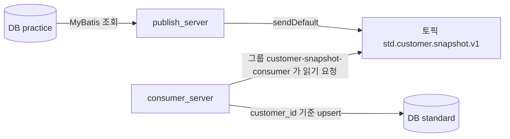
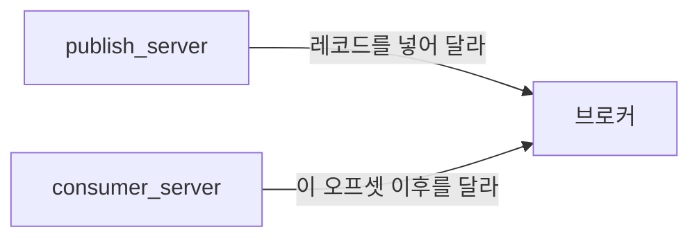

# source-to-kafka

원천 PostgreSQL을 조회 SQL에서 표준 필드로 바꾼 뒤 Kafka에 넣고, 다른 프로세스가 그 토픽을 읽어 표준 DB에 적재한다.



| 폴더 | 역할 |
| --- | --- |
| [publish_server](publish_server) | `practice.src_cust`를 읽어 `std.customer.snapshot.v1`로 발행. 포트 8080 |
| [consumer_server](consumer_server) | 그 토픽을 읽어 `standard.std_customer`에 저장. HTTP 포트 없음 |
| [scripts/start-kafka.ps1](scripts/start-kafka.ps1) | 브로커 3대를 `docker run`으로 띄움 |
| [docs/flow.md](docs/flow.md) | 전체 개념과 `publish_server`, 브로커, `consumer_server` 안의 실제 순서 |
| [docs/kafka-basics.md](docs/kafka-basics.md) | 토픽 이름, 세그먼트, 오프셋 |
| [docs/kafka.md](docs/kafka.md) | 퍼블리셔가 보낼 때와 컨슈머가 구독해 적재할 때의 순서 |

## 구동 순서

1. 데이터베이스 두 개를 만든다. 테이블은 각 앱이 기동할 때 만든다.

```sql
CREATE DATABASE practice;
CREATE DATABASE standard;
```

계정이 `postgres` / `postgres`가 아니면 각 앱의 `src/main/resources/application.yml`을 수정한다.

2. 프로젝트 루트에서 브로커를 띄운다.

```powershell
.\scripts\start-kafka.ps1
```

3. `D:\dev_project`에서 퍼블리셔를 띄운다. `src_cust`와 샘플 3건을 만들고 토픽으로 보낸다.

```powershell
cd D:\dev_project\publish_server
.\mvnw.cmd spring-boot:run
```

4. 다른 터미널을 다시 `D:\dev_project`에서 연 뒤 컨슈머를 띄운다. 그룹에 저장된 위치가 없으면 토픽에 남아 있는 메시지부터 읽어 `std_customer`에 넣는다.

```powershell
cd D:\dev_project\consumer_server
.\mvnw.cmd spring-boot:run
```

5. 퍼블리셔를 다시 보내려면 퍼블리셔가 떠 있는 상태에서 호출한다.

```powershell
Invoke-RestMethod -Method Post http://localhost:8080/api/extract/customers
```

컨슈머 로그에 `Consumed customerId=C20240001` 같은 줄이 보이고, `standard.std_customer`에 고객 3명이 있으면 끝까지 전달된 것이다. 같은 `customer_id`는 행이 늘지 않고 최신 값으로 갱신된다.

메시지 원문을 보려면 다음을 실행한다. 종료는 `Ctrl+C`다.

```powershell
docker exec -it kafka1 /opt/kafka/bin/kafka-console-consumer.sh --bootstrap-server kafka1:19092 --topic std.customer.snapshot.v1 --from-beginning --property print.key=true
```

## 컨슈머가 읽는 방식

`consumer_server`는 실무에서 가장 흔한 at-least-once 구성이다.

- 그룹 이름은 `customer-snapshot-consumer`로 고정한다. 재기동해도 같은 그룹의 저장 위치를 찾는다.
- `enable-auto-commit`은 꺼 둔다. DB `upsert`가 커밋된 뒤에만 `acknowledge`로 오프셋을 커밋한다.
- 저장 전에 프로세스가 죽으면 그 레코드를 다시 받는다. `customer_id` 기준 `ON CONFLICT DO UPDATE`라서 다시 받아도 행이 중복되지 않는다.
- 그룹에 저장된 위치가 없을 때만 `earliest`가 적용된다. 이 실습은 건수가 적어서, 컨슈머를 퍼블리셔보다 나중에 켜도 이미 쌓인 샘플을 읽는다. 하루 수천만 건인 토픽에 새 그룹을 `earliest`로 붙이면 보관 구간 전체를 다시 처리하므로, 그때는 `latest`나 특정 오프셋으로 시작한다.
- 이미 커밋이 있으면 재기동은 그 다음 오프셋부터 읽는다. 처음부터 다시 읽지 않는다.

## 테이블과 토픽

테이블을 표준 메시지로 보낼 때, 실무에서는 테이블 하나가 토픽 하나인 경우가 많다. 이 저장소도 그렇다. 원천 테이블은 `src_cust` 하나이고 토픽은 `std.customer.snapshot.v1` 하나다.

고객, 주문, 상품을 서로 다른 형식으로 보내면 토픽도 세 개가 일반적이다. 한 토픽에 세 형식을 섞으면 컨슈머가 값을 매번 구분해야 한다. 주문 헤더와 주문 상세처럼 두 표가 하나의 업무 메시지가 될 때만 토픽 하나로 합친다.

## 토픽은 누가 만드나

`kafka-topics.sh --create`는 필요 없다. 퍼블리셔에도 기동 시 토픽을 만드는 코드는 없다. 이름만 `publish_server`의 `spring.kafka.template.default-topic`에 있다.

브로커 자동 생성이 켜져 있다. 퍼블리셔가 처음 `sendDefault`에 성공하면 `std.customer.snapshot.v1`이 생긴다. 파티션 1개, 복사본 3개, 최소 동기 복사본 2개는 [scripts/start-kafka.ps1](scripts/start-kafka.ps1)의 브로커 기본값이다. 브로커가 3대보다 적으면 복사본 3개를 만들지 못해 첫 발행이 실패할 수 있다.

컨슈머만 먼저 띄우면 `UNKNOWN_TOPIC_OR_PARTITION`이 나온다. 접속 실패가 아니라 아직 토픽이 없다는 경고다. 퍼블리셔가 첫 전송에 성공하면 컨슈머는 이어서 읽는다.

## 브로커와 복제

브로커는 메시지를 디스크에 보관하는 Kafka 서버 한 대다. 이 저장소는 `kafka1`, `kafka2`, `kafka3` 세 대다. 퍼블리셔와 컨슈머는 `localhost:9092`, `localhost:9094`, `localhost:9096` 중 살아있는 주소로 붙는다.

토픽은 프로세스처럼 죽지 않는다. 장애가 나는 것은 브로커다. 파티션은 1개이고, 그 한 칸의 사본이 브로커 3대에 있다. 사본 개수가 복제 계수 3이다. 리더가 쓰기를 받고 나머지 두 대가 따라 적는다. 리더가 죽으면 남은 사본이 리더가 된다.

`acks=all`과 `min.insync.replicas=2`는 동기 복사본 2개 이상이 저장해야 발행 성공이라는 뜻이다. 브로커 1대가 죽어도 전송은 계속된다. 2대가 죽으면 새 전송은 실패한다.

```powershell
docker stop kafka1
docker start kafka1
docker logs -f kafka1
docker stop kafka1 kafka2 kafka3
```

## 프로듀서, 브로커, 컨슈머

프로듀서와 컨슈머는 서로를 호출하지 않는다. 둘 다 브로커에게 요청한다. 브로커가 컨슈머를 찾아가 밀어 넣지 않는다.



프로듀서의 ack는 브로커가 저장했다는 응답이다. 컨슈머가 읽었다는 뜻이 아니다. 컨슈머는 주기적으로 읽기를 요청하고, 없으면 잠시 뒤 다시 요청한다.

읽기 위치는 컨슈머 그룹이 파티션별로 기억한다. 토픽은 누가 어디까지 읽었는지 기억하지 않는다.

| 상황 | 다음에 요청하는 위치 |
| --- | --- |
| 그룹이 10번까지 처리했다고 커밋함 | 11번. 재기동해도 같다 |
| 저장된 위치가 없고 `earliest` | 아직 삭제되지 않은 가장 오래된 메시지부터 끝까지 |
| 저장된 위치가 없고 `latest` | 지금 이후만. 그 전 메시지는 이 그룹이 받지 않음 |

`earliest`는 재기동할 때마다 처음부터 읽으라는 설정이 아니다. 그 그룹에 저장된 번호가 없을 때만 쓰인다.

## 퍼블리셔 안의 흐름

기동 시 `CustomerExtractStartupRunner`가, 수동으로는 `POST /api/extract/customers`가 같은 `publishAll`을 호출한다.

1. `LegacyCustomerMapper.xml`의 SELECT가 `src_cust` 전 건을 표준 필드로 바꿔 가져온다. 자바에서 컬럼을 다시 바꾸지 않는다.
2. 고객 한 명마다 `sendDefault(customerId, message)`로 보낸다. 키는 `customerId`다.
3. 브로커 ack를 최대 10초 기다린 뒤 성공 건수를 센다. 한 건이 실패해도 다음 고객은 계속 보낸다.

`app.extract.on-startup=false`면 기동 시에는 뽑지 않고 HTTP 트리거만 남는다. 퍼블리셔를 다시 띄우면 같은 3명을 토픽 뒤에 한 벌 더 넣는다. 컨슈머는 그 새 오프셋만 읽고, `std_customer`의 같은 `customer_id` 행을 갱신한다.

## 컨슈머 안의 흐름

`CustomerSnapshotListener`가 토픽 `std.customer.snapshot.v1`을 그룹 `customer-snapshot-consumer`로 읽는다.

1. 브로커에 다음 오프셋의 JSON을 요청한다.
2. `CustomerSinkService`가 문자열 날짜를 날짜 타입으로 바꾼 뒤 `StdCustomerMapper`로 `std_customer`에 upsert 한다.
3. DB 트랜잭션이 커밋된 다음 `acknowledge`로 그 오프셋을 그룹에 기록한다.
4. 로그에 `Consumed customerId=...`를 남긴다.

저장이 실패하면 커밋하지 않는다. 컨슈머가 다시 뜨면 그 레코드부터 다시 받아 upsert 한다.

## 컬럼 대응

| 원천 `practice.src_cust` | Kafka JSON | 적재 `standard.std_customer` |
| --- | --- | --- |
| `cust_no` | `customerId` | `customer_id` |
| `cust_nm` | `customerName` | `customer_name` |
| `mbl_telno` | `mobilePhoneNumber` | `mobile_phone_number` |
| `email_addr` | `email` | `email` |
| `brdt` | `birthDate` | `birth_date` |
| `sex_cd` | `gender` | `gender` |
| `rdnm_addr` | `roadAddress` | `road_address` |
| `reg_dt` | `registeredAt` | `registered_at` |
| `mdfcn_dt` | `modifiedAt` | `modified_at` |
| `use_yn` | `active` | `active` |

원천에서 JSON까지의 값 변환은 `publish_server/src/main/resources/mapper/LegacyCustomerMapper.xml`의 SELECT가 한다.

- `brdt` `19900315`는 `birthDate` `1990-03-15`다. 비었거나 8자리 숫자가 아니거나, 달력에 없는 날이면 `birthDate`만 null이고 그 행은 그대로 보낸다.
- `sex_cd` `1`/`M`은 `MALE`, `2`/`F`는 `FEMALE`, 그 외는 `UNKNOWN`이다.
- `use_yn`이 `Y`일 때만 `active`가 true다.
- `reg_dt`, `mdfcn_dt`는 시간대 없는 시각에 `+09:00`을 붙인 문자열이다.
- `sourceSystem`은 `LEGACY_CUST`, `eventType`은 `CUSTOMER_SNAPSHOT`이다. `extractedAt`은 그 SELECT가 실행된 한국 시각이다.
- `consumed_at`은 컨슈머가 `std_customer`에 넣은 시각이다. 컨슈머는 이미 만들어진 JSON을 날짜 타입으로 읽어 저장만 한다.

## 파티션, 오프셋, 세그먼트

이 토픽의 파티션은 1개다. JSON 한 객체는 그 칸에 한 줄씩 추가되고, 줄마다 오프셋이 1씩 늘어난다. 세그먼트는 그 줄들을 담는 디스크 파일이며, 메시지마다 파일이 생기지 않는다. 샘플 3건은 파티션 0의 활성 세그먼트 하나에 오프셋 0, 1, 2로 들어간다.

파티션을 나누는 것은 무중단이 아니다. 칸을 늘리면 컨슈머가 나눠 읽을 수 있지만, 토픽 전체 순서는 칸 안에서만 유지된다. 브로커 한 대가 죽어도 전송이 되는 것은 같은 칸을 브로커 3대에 복제해 두었기 때문이다.

자세한 그림은 [docs/kafka-basics.md](docs/kafka-basics.md)에 있다.
