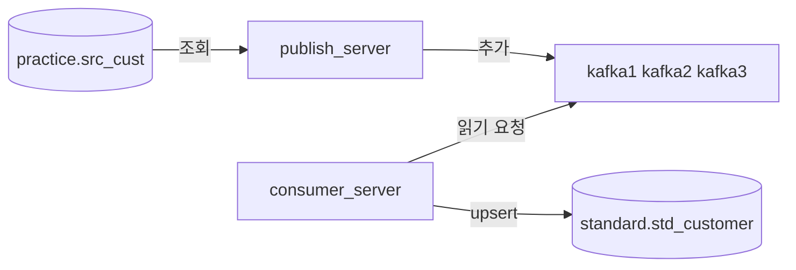
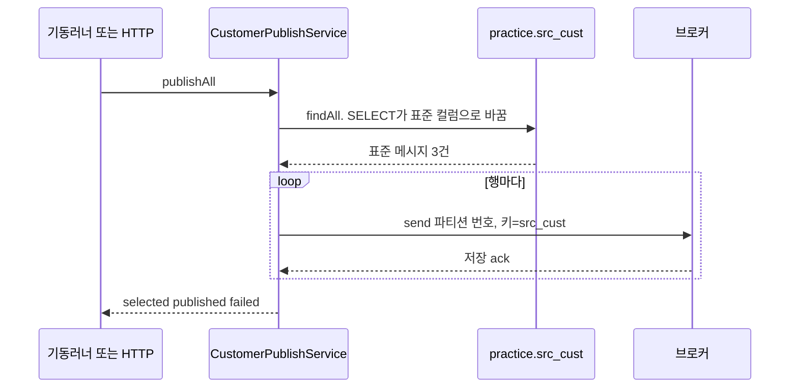
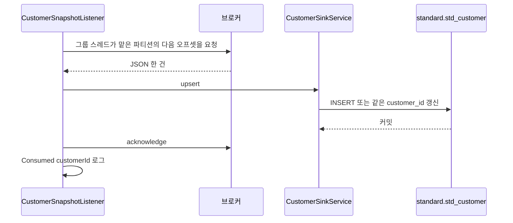

# 지금 프로젝트의 흐름

이 글은 개념과 코드가 같은 순서로 이어지게 적었다. 실행 명령은 [README.md](../README.md), Kafka 용어는 [kafka-basics.md](kafka-basics.md), 설정 항목은 [kafka.md](kafka.md)에 있다.

## 한 줄

`practice` DB의 고객 3명을 `publish_server`가 조회 SQL로 표준 필드를 만든 뒤 Kafka에 넣는다. `consumer_server`가 그 JSON을 읽어 `standard` DB에 넣는다. 두 서버는 서로를 호출하지 않는다. 가운데 Kafka 브로커만 공유한다.

## 각 상자가 하는 일

| 상자 | 하는 일 | 하지 않는 일 |
| --- | --- | --- |
| `practice` | 원천 표 `src_cust`를 보관한다 | 표준 컬럼 이름을 알지 못한다 |
| `publish_server` | 조회 SQL로 표준 필드를 만든 뒤 JSON으로 보내고, 브로커가 저장했다고 답할 때까지 기다린다 | 토픽을 구독하지 않는다. 자바에서 컬럼을 다시 바꾸지 않는다. 표준 DB에 쓰지 않는다 |
| 브로커 3대 | 토픽 `std.customer.snapshot.v1`에 레코드를 추가하고 복사본을 유지한다 | 컨슈머를 찾아가 밀어 넣지 않는다. 읽었다고 레코드를 지우지 않는다 |
| `consumer_server` | 자기 그룹의 다음 오프셋을 요청하고, DB에 넣은 뒤에만 그 위치를 기록한다 | 원천 DB를 보지 않는다. HTTP API가 없다 |
| `standard` | 고객 한 명당 `std_customer` 한 행을 보관한다 | 토픽의 과거 레코드를 기억하지 않는다 |

## 바깥에서 보이는 순서

1. PostgreSQL에 `practice`와 `standard`가 있다. 표는 각 서버가 처음 뜰 때 만든다.
2. `scripts/start-kafka.ps1`가 브로커 3대를 띄운다. 이 시점에는 토픽이 아직 없다.
3. `publish_server`가 뜬다. `src_cust`와 샘플 3건을 만든 뒤 토픽으로 보낸다. 첫 전송에 성공하면 브로커가 토픽을 만든다. 파티션 3개, 복사본 3개다.
4. `consumer_server`가 뜬다. 그룹 `standard-snapshot-consumer`에 스레드 3개가 붙고, 저장된 위치가 없으면 파티션마다 남아 있는 건을 읽어 `std_customer`에 넣는다.
5. 같은 고객을 다시 보내면 토픽 뒤에는 메시지가 더 붙고, `std_customer`는 같은 `customer_id` 행만 갱신된다.

## publish_server 안에서

진입점은 두 개고, 둘 다 `CustomerPublishService.publishAll()`만 호출한다.

- 기동 직후: `CustomerExtractStartupRunner`. `app.extract.on-startup=false`면 여기서 끝난다.
- 수동: `POST /api/extract/customers`. `CustomerExtractController`가 같은 메서드를 호출하고, 조회 건수와 성공·실패 건수를 돌려준다. 일부만 실패해도 HTTP 200이다.

`publishAll()` 한 번의 안쪽은 이렇다.

1. `schema.sql`로 `src_cust`를 만들고 `data.sql`로 샘플 3건을 넣는다. 이미 있으면 그대로 둔다. DB에 접속하지 못하면 서버는 뜨지 않는다.
2. `LegacyCustomerMapper.findAll`의 SELECT가 `cust_no` 순으로 전 건을 가져오면서 표준 필드를 만든다. `publishAll`은 그 결과를 그대로 보낸다. `brdt` `19900315`는 `1990-03-15`, `sex_cd` `1`/`M`은 `MALE`, `2`/`F`는 `FEMALE`, 그 외는 `UNKNOWN`, `use_yn` `Y`는 `active=true`다. `reg_dt`와 `mdfcn_dt`에는 `+09:00`을 붙인다. 생일이 비었거나 8자리 숫자가 아니거나, `to_date`가 넘긴 날이 원문과 다르면 `birthDate`만 null이고 그 행은 계속 보낸다. `sourceSystem`은 `LEGACY_CUST`, `eventType`은 `CUSTOMER_SNAPSHOT`, `extractedAt`은 조회 시각이다. 조회 자체가 실패하면 예외가 호출자까지 올라간다.
3. `SnapshotSender`가 파티션 수를 조회한 뒤 `kafkaTemplate.send(토픽, 파티션, "src_cust", message)`로 `std.customer.snapshot.v1`에 보낸다. 행마다 파티션 0, 1, 2를 돌아간다. 키는 테이블명 `src_cust`로 고정된다. 토픽이 없으면 이 첫 전송 때 브로커가 파티션 3개로 만든다.
4. `.get(10초)`로 브로커의 저장 응답을 기다린다. 이 응답은 컨슈머가 읽었다는 뜻이 아니다. 리더와 동기 복사본이 최소 2개 저장되면 성공이다.
5. 한 건이 10초 안에 ack를 받지 못하면 그 `customerId`만 `failedKeys`에 넣고 다음 고객을 계속 보낸다. 스레드가 인터럽트된 경우에만 루프를 멈춘다.
6. 로그에 `Published customerId=C20240001 topic=std.customer.snapshot.v1`, 마지막에 `selected`, `published`, `failed`가 남는다.

Kafka가 꺼져 있어도 퍼블리셔 프로세스는 남는다. 브로커를 띄운 뒤 같은 POST를 다시 호출하면 된다.

## 브로커 안에서

샘플 3건은 키가 모두 `src_cust`이고, 파티션 0, 1, 2의 활성 세그먼트에 오프셋 0으로 한 건씩 들어간다.

| 순서 | 파티션 | 오프셋 | 키 | 값 |
| --- | --- | --- | --- | --- |
| 김민수 | 0 | 0 | `src_cust` | 표준 고객 JSON 한 객체 |
| 이서연 | 1 | 0 | `src_cust` | 표준 고객 JSON 한 객체 |
| 박지훈 | 2 | 0 | `src_cust` | 표준 고객 JSON 한 객체 |

칸마다 사본이 `kafka1`, `kafka2`, `kafka3`에 있다. 쓰기를 받는 대가 그 칸의 리더다. 브로커 1대가 죽어도 동기 복사본 2대가 남으면 새 전송은 된다. 2대가 죽으면 새 전송은 실패하고, 이미 저장한 줄은 남은 브로커에 그대로 있다.

퍼블리셔를 다시 띄우면 각 칸의 오프셋 0은 바뀌지 않는다. 같은 순서로 다시 보내면 각 칸의 다음 번호에 한 줄씩 추가된다.

## consumer_server 안에서

HTTP 포트는 없다. 기동하면 DB에 붙고, 리스너가 브로커에 읽기를 요청하기 시작한다.

1. `standard` DB에 접속하고 `schema.sql`로 `std_customer`를 만든다. 샘플 행은 넣지 않는다. DB에 접속하지 못하면 서버는 뜨지 않는다.
2. `CustomerSnapshotListener`가 고객 토픽을 구독한다. 그룹 이름은 `standard-snapshot-consumer` 하나다. `concurrency: 3`이라 스레드 3개가 생기고, 브로커가 파티션을 하나씩 배정한다. 리스너 메서드는 파티션 번호를 인자로 받지 않는다.
3. 그 그룹이 이 파티션을 어디까지 처리했는지는 브로커의 내부 토픽에 있다. 기록이 없으면 `earliest`라서 아직 삭제되지 않은 가장 오래된 줄부터 요청한다. 기록이 있으면 그 다음 오프셋만 요청한다.
4. 받은 JSON을 `StandardCustomerMessage`로 바꾼다. 퍼블리셔가 클래스 이름을 헤더에 넣지 않으므로, 컨슈머 yml의 `spring.json.value.default.type`이 이 클래스를 지정한다.
5. `CustomerSinkService.upsert`가 `birthDate`는 날짜, 시각 필드는 오프셋 있는 시각으로 바꾼 뒤 `StdCustomerMapper`를 호출한다.
6. SQL은 `INSERT ... ON CONFLICT (customer_id) DO UPDATE`다. `consumed_at`은 DB의 `now()`다. 메서드가 정상으로 끝나면 트랜잭션이 커밋된 상태다.
7. 그 다음에만 `acknowledgment.acknowledge()`가 나간다. 자동 커밋은 꺼져 있다. 로그는 `Consumed customerId=C20240001`이다.
8. 5번이나 6번에서 실패하면 커밋하지 않는다. 프로세스가 다시 뜨면 같은 줄을 다시 받아 upsert 한다. 같은 `customer_id`라서 행은 두 개가 되지 않는다.

컨슈머만 먼저 띄우면 `UNKNOWN_TOPIC_OR_PARTITION`이 나올 수 있다. 접속이 끊긴 것이 아니라 토픽이 아직 없다는 경고다. 퍼블리셔가 첫 전송에 성공하면 이어서 읽는다.

## 김민수 한 명이 지나가는 길

| 단계 | 어디에 | 무엇이 |
| --- | --- | --- |
| 원천 | `practice.src_cust` | `cust_no=C20240001`, `cust_nm=김민수`, `brdt=19900315`, `sex_cd=1`, `use_yn=Y` |
| 조회 | `publish_server`의 SELECT | `customerId=C20240001`, `customerName=김민수`, `birthDate=1990-03-15`, `gender=MALE`, `active=true` |
| 토픽 | 파티션 0 오프셋 0 | 키 `C20240001`, 값은 위 JSON |
| 적재 | `standard.std_customer` | `customer_id=C20240001` 한 행. `consumed_at`은 넣은 시각 |

다시 발행하면 토픽에는 김민수의 JSON이 새 오프셋으로 한 줄 더 생기고, `std_customer`의 `C20240001` 행은 그 최신 값으로 바뀐다.

## 다시 띄우면

| 다시 띄운 것 | 결과 |
| --- | --- |
| 브로커만 | 디스크의 레코드와 그룹이 기록한 오프셋은 남는다 |
| `publish_server` | `src_cust` 전 건을 토픽 뒤에 한 벌 더 추가한다. 컨슈머가 이미 앞서 있으면 새 오프셋만 읽어 같은 3행을 갱신한다 |
| `consumer_server` | 그룹에 커밋이 있으면 다음 오프셋부터 읽는다. 처음부터 다시 읽지 않는다 |
| 그룹 기록이 없는 새 컨슈머 | `earliest`라서 보관 중인 첫 줄부터 읽는다. 이 실습은 건수가 적어 샘플이 다시 들어온다. 건수가 아주 많은 토픽에서는 새 그룹을 `latest`로 시작한다 |
