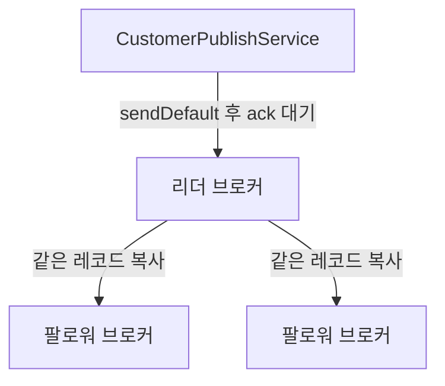
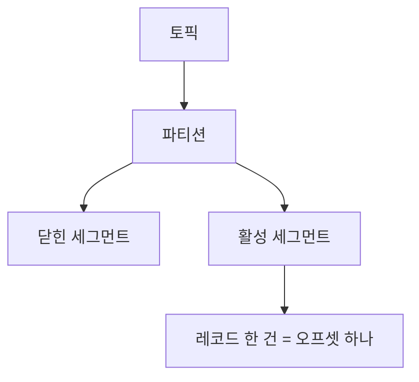
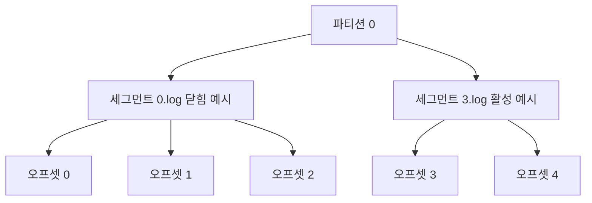
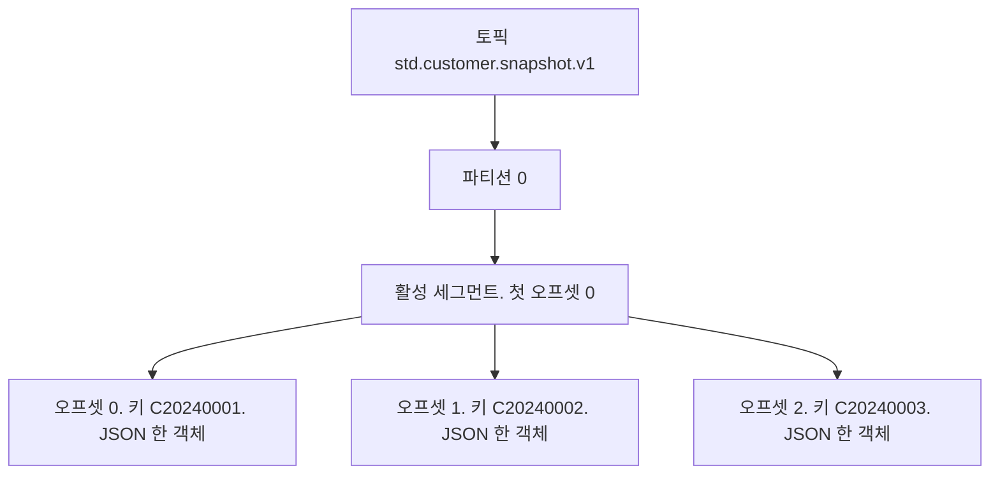
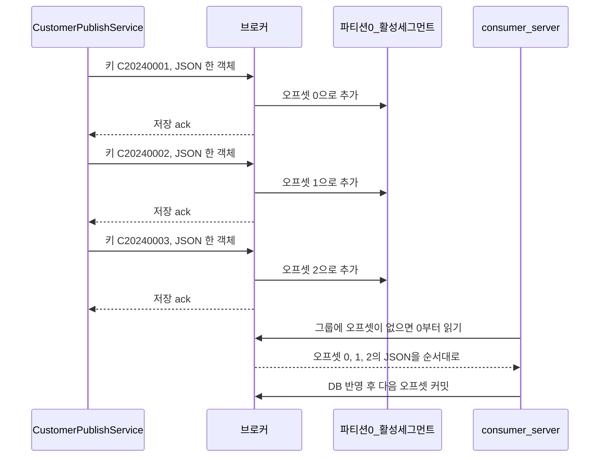
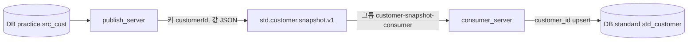

# Kafka를 처음 쓸 때

이 문서는 Kafka를 모르는 상태에서 이 프로젝트를 볼 때를 기준으로 설명한다. 실행 명령은 [README.md](../README.md), 퍼블리셔와 컨슈머가 기동할 때 어디서 붙는지는 [kafka.md](kafka.md)에 있다.

## 이 저장소에서 Kafka가 하는 일

`publish_server`의 조회 SQL이 고객 행을 표준 필드로 바꾼 뒤 토픽 `std.customer.snapshot.v1`에 넣는다. `consumer_server`가 그 토픽을 읽어 `standard` DB에 넣는다. 콘솔 컨슈머는 적재하지 않고 토픽 원문만 확인할 때 쓴다.

퍼블리셔는 브로커 주소 세 개와 `default-topic`을 설정한다. 컨슈머는 같은 브로커 주소, 그룹 `customer-snapshot-consumer`, `app.kafka.topic`을 설정한다. 토픽을 미리 만드는 명령은 없다. 브로커 3대가 떠 있는 뒤 퍼블리셔가 처음 보내면, 복제 3으로 그 토픽이 생긴다.

## 이름부터

| 이름 | 한 줄 |
| --- | --- |
| 브로커 | 메시지를 디스크에 저장하는 Kafka 서버 한 대. 이 실습은 `kafka1`(9092), `kafka2`(9094), `kafka3`(9096) 세 대다 |
| 토픽 | 메시지를 쌓아 두는 이름의 통. 데이터베이스의 테이블 이름에 가깝다. 이 실습의 통 이름은 `std.customer.snapshot.v1` |
| 메시지 | 토픽에 한 번 넣는 기록 한 건. 키와 값으로 이루어진다 |
| 키 | 이 실습에서는 `customerId`. 같은 키는 같은 파티션에 들어간다 |
| 값 | 표준 고객 JSON. `customerName`, `gender`, `birthDate` 같은 필드 |
| 파티션 | 토픽 안의 순서 있는 저장 칸. 이 실습은 칸이 1개다. 복제 3은 칸을 3개로 나누는 것이 아니라, 그 한 칸의 사본을 브로커 3대에 둔다 |
| 프로듀서 | 메시지를 넣는 프로그램. `CustomerPublishService` |
| 컨슈머 | 메시지를 읽는 프로그램. 이 저장소에서는 `consumer_server`의 `CustomerSnapshotListener`다. 콘솔 컨슈머는 확인용이다 |
| 오프셋 | 파티션 안에서 메시지의 번호. 컨슈머는 “몇 번까지 읽었는지”를 자기 위치로 기억한다 |
| 컨슈머 그룹 | 같이 읽기로 묶인 컨슈머 이름. 그룹이 다르면 같은 메시지를 각자 처음부터 다시 읽을 수 있다 |

토픽은 같은 고객을 다시 보내도 기존 레코드를 고치지 않는다. 새 메시지가 뒤에 추가된다. 퍼블리셔를 두 번 띄우면 샘플 3명이 토픽에 두 벌 쌓인다. `consumer_server`가 넣는 `std_customer`는 그와 다르다. `customer_id`가 같으면 행을 추가하지 않고 최신 값으로 갱신한다.

읽는 즉시 지워지지도 않는다. `consumer_server`를 종료해도 토픽의 메시지는 남아 있다. 같은 그룹으로 다시 띄우면 이미 커밋한 다음 오프셋부터 읽는다. `--from-beginning`으로 처음부터 다시 보는 것은 확인용 콘솔 컨슈머다.

## 브로커가 죽어도 전송이 되는 이유

토픽은 따로 죽지 않는다. 장애가 나는 것은 그 토픽의 로그를 들고 있는 브로커다. 예전 구성은 브로커 1대와 복제 1이라, 그 한 대가 멈추면 사본이 없어 전송도 멈췄다. 복제 계수가 이미 3이었던 것은 아니다.

지금은 파티션 0의 같은 로그를 브로커 3대가 가진다. 쓰기를 받는 대를 리더라 하고, 나머지를 팔로워라 한다. 리더가 죽으면 남은 팔로워 중 하나가 리더가 된다.



앱의 `acks=all`은 리더 혼자 받았다고 성공으로 치지 않는다. 브로커 설정 `min.insync.replicas=2`와 만나, 리더를 포함해 동기 복사본이 2개 이상 저장했을 때 성공이다. 그래서 브로커 1대를 `docker stop` 해도 2대가 남으면 `published`는 계속 올라간다. 2대를 멈추면 동기 복사본이 1개뿐이라 새 전송은 실패하고, 이미 ack 된 레코드는 남은 브로커의 세그먼트에 남아 있다.

첫 접속 주소는 `localhost:9092,localhost:9094,localhost:9096`이다. 이 중 하나가 죽어 있어도 클라이언트는 목록의 다른 주소로 메타데이터를 받아 현재 리더를 찾는다.

원본 전용 브로커가 따로 있어 4대인 것은 아니다. 브로커는 `kafka1`, `kafka2`, `kafka3` 세 대이고, 사본 3개는 리더 1대와 팔로워 2대를 합친 수다.

## 컨슈머는 사본을 몇 벌 받나

`consumer_server`의 그룹 `customer-snapshot-consumer`는 파티션 0의 리더에게만 다음 오프셋을 요청한다. 팔로워 두 대의 사본을 같이 읽지 않는다. 김민수, 이서연, 박지훈은 그 칸에서 한 번씩만 온다.

리더가 죽으면 남은 팔로워 중 하나가 새 리더가 된다. 컨슈머는 그 리더에게 요청을 옮기고, 그룹이 이미 커밋한 다음 오프셋부터 이어서 읽는다.

그룹이 나누는 단위는 브로커가 아니라 파티션이다. 이 토픽은 파티션이 1개라 그룹 안에서는 컨슈머 한 대만 그 칸을 읽는다.

### 테이블이 1개일 때

| 항목 | 이 프로젝트 |
| --- | --- |
| 테이블 | `src_cust` 1개 |
| 토픽 | `std.customer.snapshot.v1` 1개 |
| 파티션 | 1개 |
| 브로커 | 3대. 파티션 0의 사본이 각 브로커에 1벌 |
| 컨슈머 그룹 | `customer-snapshot-consumer` 1개 |

### 테이블이 3개일 때

고객, 주문, 상품처럼 표가 다르면 토픽도 보통 3개다. 브로커는 그대로 3대다. 토픽마다 파티션 1개와 사본 3개라면, 디스크에는 토픽마다 같은 로그가 3벌 있다.

컨슈머 그룹 수는 브로커 수가 정하지 않는다. 적재 앱이 이 프로젝트처럼 하나면 그룹도 1개로 두고, 그 그룹이 토픽 3개를 구독하는 경우가 많다. 읽을 칸은 고객 파티션 0, 주문 파티션 0, 상품 파티션 0이다. 컨슈머 한 대가 그 3칸을 모두 맡으면 각 칸의 메시지를 한 번씩만 받는다. 사본까지 더해 9벌을 받지 않는다.

그룹을 3개로 나누는 것은 적재 앱이 3개일 때다. 각 그룹은 자기 토픽만 구독하고, 그 토픽도 한 벌만 읽는다. 같은 토픽을 그룹 2개가 구독하면 그룹마다 한 벌씩 전달된다. 그 횟수는 브로커 사본 수와 별개다.

## 토픽이란 무엇인가

토픽은 브로커 안에 만드는 로그 이름이다. 프로듀서는 그 이름 뒤로 메시지를 추가하고, 컨슈머는 그 이름을 구독해서 읽는다.

이 실습에는 토픽이 하나다.

```text
std.customer.snapshot.v1
```

퍼블리셔 코드는 이 문자열을 직접 들고 있지 않다. `publish_server`의 `application.yml`에서 `sendDefault`가 다음 값을 사용한다. 컨슈머는 같은 문자열을 `app.kafka.topic`으로 구독한다.

```yaml
spring:
  kafka:
    template:
      default-topic: std.customer.snapshot.v1
```

콘솔에 아래 경고가 보이면, 그 이름의 토픽이 아직 없다는 뜻이다.

```text
UNKNOWN_TOPIC_OR_PARTITION
```

`consumer_server`나 콘솔 컨슈머를 퍼블리셔보다 먼저 실행하면 흔히 나온다. 퍼블리셔가 첫 메시지를 보내 토픽이 생기면 이어서 읽는다. 토픽을 손으로 만드는 단계는 이 실습에 없다.

## `std.customer.snapshot.v1`에 점이 있는 이유

점은 Kafka가 토픽을 계층으로 나누는 문법이 아니다. 토픽 이름은 하나의 문자열이고, `.` `_` `-` 와 영숫자만 허용된다. 점은 사람이 이름을 구간별로 읽으려고 넣는 관례다.

이 이름은 네 구간이다.

| 구간 | 값 | 의미 |
| --- | --- | --- |
| 규격 | `std` | 원천 컬럼이 아니라 표준 필드 JSON이라는 표시. 원천 그대로면 `raw`나 `legacy`를 쓰는 팀이 있다 |
| 대상 | `customer` | 고객 데이터. 주문이 생기면 `order`처럼 대상이 바뀐다 |
| 종류 | `snapshot` | 테이블에 있는 행을 그 시점의 전체 모습으로 보낸다는 뜻. 한 건의 변경만 보내면 `event`나 `cdc`를 쓰는 경우가 많다 |
| 버전 | `v1` | 이 JSON 필드의 첫 규격. 필드를 호환되지 않게 바꾸면 `v2` 토픽을 새로 만들고, 기존 소비자는 `v1`을 계속 읽게 둔다 |

그래서 이 토픽은 “표준 규격의 고객 스냅샷, 1번 규격”이다. 회사마다 `std.customer.snapshot.v1`, `STD_CUSTOMER_SNAPSHOT_V1`, `std-customer-snapshot-v1`처럼 구분 문자만 다르다. 셋 다 Kafka에게는 서로 다른 문자열일 뿐이고, 점 자체가 특별한 기능을 하지는 않는다.

점을 자주 쓰는 이유는 이름이 길어져도 구간이 눈에 들어와서다. 토픽이 늘어나면 `std.customer.snapshot.v1`, `std.order.snapshot.v1`처럼 앞부분을 맞춰 나열한다.

한 가지 실무 주의가 있다. 예전 Kafka 모니터링에서는 토픽 이름의 `.`과 `_`가 지표 이름에서 같은 글자로 취급되어 겹칠 수 있었다. 그래서 한 이름 안에 점과 밑줄을 섞지 않는 팀이 있다. 이 실습 이름은 점만 쓰므로 그 문제에 해당하지 않는다.

## 메시지 한 건의 모습

한 행이 토픽에 들어가면 대략 다음 형태다. 앞의 `C20240001`이 키이고, 뒤가 값이다.

```text
C20240001   {"customerId":"C20240001","customerName":"김민수","gender":"MALE","birthDate":"1990-03-15","active":true,...}
```

키를 쓰는 이유는 순서다. 같은 `customerId`는 같은 파티션에 계속 들어가서, 그 고객의 이전 메시지와 이후 메시지의 순서가 유지된다. 키 없이 보내면 메시지가 파티션에 나뉘어 들어가고, 같은 고객의 두 메시지가 다른 칸에 있을 수 있다.

값의 필드 이름과 형식은 조회 SQL이 이미 표준으로 만들어 둔 것이다. 자바는 그 객체를 JSON 바이트로 직렬화만 한다. JSON 앞에 자바 클래스 이름은 붙이지 않는다. 다른 언어로 읽는 쪽이 클래스 이름에 의존하지 않게 하려는 설정이다.

## 파티션, 세그먼트, 오프셋

한 토픽의 안쪽은 이렇게 겹친다. 파티션이 저장 칸이고, 세그먼트는 그 칸을 디스크에 나눠 담는 파일이고, 오프셋은 그 칸 안에서 메시지 한 건에 붙는 번호다.



| 단위 | 무엇을 세나 | 이 실습에서 |
| --- | --- | --- |
| 토픽 | 이름 하나. 파티션을 묶는다 | `std.customer.snapshot.v1` 하나 |
| 파티션 | 순서가 유지되는 저장 칸. 칸마다 오프셋이 0부터 따로 센다 | 파티션 0 하나. 스크립트가 `KAFKA_NUM_PARTITIONS=1`로 고정한다. 그 칸의 사본은 브로커 3대에 있다 |
| 세그먼트 | 파티션 로그를 자른 파일. 연속된 오프셋 여러 건이 들어간다 | 샘플 3건은 작아서 첫 활성 세그먼트 하나에 다 들어간다. 메시지 한 건이 세그먼트 하나는 아니다 |
| 오프셋 | 파티션 안의 레코드 한 건. JSON 필드 개수나 바이트 수가 아니다 | 첫 고객이 0, 다음이 1, 그 다음이 2 |
| 레코드 | 브로커가 저장하는 한 줄. 오프셋, 키, 값, 시각이 들어 있다 | 키는 `customerId`, 값은 고객 JSON 한 객체 |

오프셋은 토픽 전체가 아니라 **파티션마다** 0부터 매긴다. 파티션이 두 개면 각 칸에 오프셋 0이 따로 있다. 이 실습은 칸이 하나라 번호가 한 줄로만 늘어난다.

세그먼트는 그 번호를 파일로 잘라 둔 것이다. 기본은 파일이 약 1GB가 되거나, 시간을 넘겨 새 파일을 열 때 다음 세그먼트가 생긴다. 새 파일의 이름은 그 파일의 첫 오프셋이다. 예를 들어 오프셋 0부터 담던 파일을 닫고 다음을 열면, 다음 파일은 그때의 다음 번호부터 시작한다. 샘플 세 건은 이 기준에 닿지 않으므로 파일은 하나다.



위 그림은 메시지가 많아져 파일이 갈라진 모습이다. 지금 샘플 3건은 아래처럼 활성 세그먼트 하나에만 있다.



디스크에서 세그먼트 하나는 보통 로그 파일과, 오프셋으로 파일 위치를 찾는 인덱스 파일로 짝을 이룬다. 컨슈머가 오프셋 1을 읽으면 브로커는 그 인덱스로 파일 안 위치를 찾고, 그 레코드의 JSON만 돌려준다.

## 이 프로젝트에서 브로커 안에 쌓이는 순서

앱은 고객 한 명마다 레코드 하나를 보낸다. `CustomerPublishService`가 `sendDefault(customerId, message)`를 호출하고, 브로커 응답을 최대 10초 기다린 뒤에야 다음 고객을 보낸다. 그래서 샘플은 파티션 0에 오프셋 0, 1, 2 순서로 들어간다.



`acks: all`은 리더와 동기 팔로워가 그 레코드를 저장했다는 응답이다. `min.insync.replicas=2`라서 브로커 한 대만 저장한 상태로는 성공이 아니다. 이 응답은 `consumer_server`가 읽었다는 뜻이 아니다.

`consumer_server`의 `earliest`는 그룹 `customer-snapshot-consumer`에 저장된 오프셋이 없을 때만 파티션 0의 가장 오래된 레코드부터 읽는다. 한 번 커밋한 뒤 재기동하면 그 다음 번호부터다. 콘솔 컨슈머는 실행마다 그룹 이름이 새로 생긴다. `--from-beginning`이 없으면 이미 쌓인 0, 1, 2를 건너뛰고 그 다음 번호만 기다릴 수 있다.

같은 고객을 다시 보내면 오프셋 0의 JSON이 바뀌지 않는다. 파티션 0의 다음 번호에 새 레코드가 추가된다. 세그먼트는 그 추가분이 1GB나 파일 교체 시간에 닿기 전까지 같은 활성 파일에 이어 붙는다.

## 넣는 쪽과 읽는 쪽



프로듀서는 브로커가 “저장했다”고 응답해야 성공으로 센다. 그 설정이 `acks: all`이다. 이 응답은 컨슈머가 읽었다는 뜻이 아니다. `consumer_server`가 떠 있어야 `std_customer`에 들어간다.

컨슈머는 그룹 단위로 오프셋을 기억한다. `customer-snapshot-consumer`는 이름을 고정해서, 재기동하면 커밋한 다음 오프셋부터 읽는다. 콘솔 컨슈머는 실행할 때마다 새 그룹 이름을 쓴다. `--from-beginning`을 붙이면 그 그룹이 오프셋 0부터 읽는다. 이 옵션이 없으면 새로 만든 그룹은 보통 지금 이후의 메시지만 읽어서, 이미 들어가 있는 샘플이 화면에 안 나올 수 있다.

## 이 실습에서 하지 않는 것

- 퍼블리셔는 토픽을 구독하지 않는다. 구독은 `consumer_server`가 한다.
- 토픽을 관리 화면이나 명령으로 미리 만들지 않는다.
- 마지막으로 보낸 시각 이후의 행만 뽑지 않는다. 호출할 때마다 테이블 전체를 다시 보낸다.
- 같은 키의 이전 메시지를 지우거나 고치지 않는다. 항상 추가다.

토픽이 여러 개가 되면 이름만 yml에 더 두고, 보낼 때 그 문자열을 지정한다. `default-topic` 칸은 이름이 하나일 때 쓰는 기본값이다.

```yaml
app:
  kafka:
    topics:
      customer: std.customer.snapshot.v1
      order: std.order.snapshot.v1
```

## 확인 순서만 다시

1. Docker로 브로커 3대를 띄운다. 명령은 [README.md](../README.md)에 있다.
2. `publish_server`를 띄운다. `published=3`이면 토픽이 생기고 샘플 3건이 들어간 것이다.
3. `consumer_server`를 띄운다. 그룹에 커밋이 없으면 그 3건을 `std_customer`에 넣는다. 퍼블리셔보다 먼저 실행했다면 `UNKNOWN_TOPIC_OR_PARTITION` 경고가 먼저 보이고, 퍼블리셔가 보낸 뒤에 적재한다.
4. 원문이 필요하면 콘솔 컨슈머로 읽는다. 이 명령은 `standard` DB를 바꾸지 않는다.
