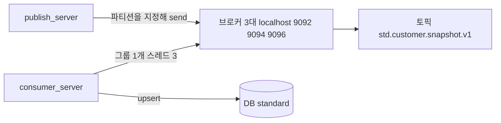
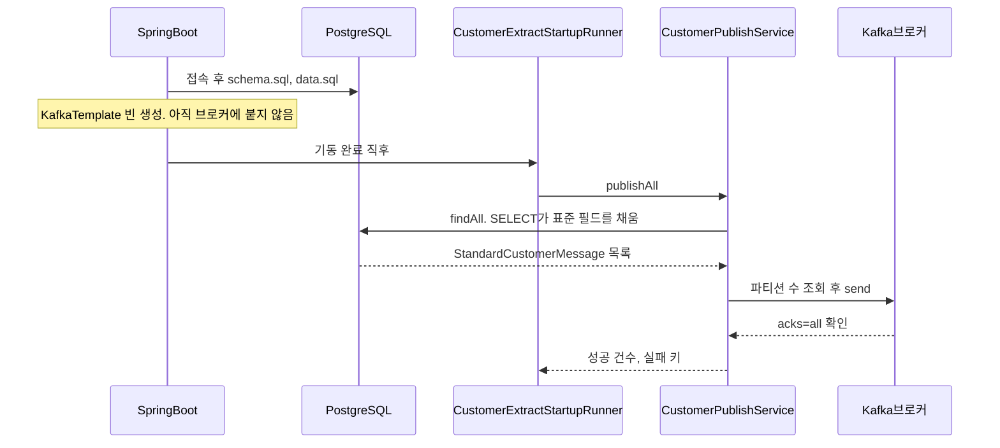
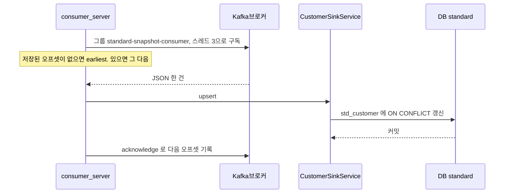

# 이 프로젝트의 Kafka

퍼블리셔(`publish_server`)는 PostgreSQL `src_cust`를 조회할 때 SQL로 표준 필드를 만든 뒤 토픽 `std.customer.snapshot.v1`에 넣습니다. 자바는 그 조회 결과를 JSON으로 직렬화만 합니다. 그 토픽을 읽어 `standard` DB에 적재하는 쪽은 `consumer_server`입니다.

Kafka 자체를 처음 보면 [kafka-basics.md](kafka-basics.md)를 먼저 읽는다. 실행 명령은 [README.md](../README.md)에 있다. 이 문서는 퍼블리셔가 보낼 때와 컨슈머가 읽어 적재할 때의 순서를 설명한다.

## 구성 요소



| 이름 | 이 프로젝트에서 |
| --- | --- |
| 브로커 | 메시지를 디스크에 보관하는 서버 한 대. `scripts/start-kafka.ps1`가 `kafka1`, `kafka2`, `kafka3`을 띄운다. 앱 주소는 `localhost:9092,localhost:9094,localhost:9096` |
| 토픽 | 메시지 통로 이름. `std.customer.snapshot.v1` |
| 파티션 | 토픽 안의 저장 칸. 이 실습은 칸이 3개다. 발행 코드가 칸 번호를 돌아가며 지정한다. 키는 `src_cust`로 고정되어 칸을 고르지 않는다 |
| 프로듀서 | 메시지를 넣는 쪽. `CustomerPublishService` |
| 컨슈머 | `consumer_server`의 `CustomerSnapshotListener`. 그룹 `standard-snapshot-consumer`의 스레드 3개가 파티션을 나눠 읽어 `standard.std_customer`에 넣는다. 콘솔 컨슈머는 적재와 별개로 원문을 보는 도구다 |
| 오프셋 | 컨슈머가 토픽의 어디를 읽었는지 나타내는 번호. 프로듀서는 오프셋을 관리하지 않습니다 |

브로커는 큐에서 메시지를 꺼내는 즉시 지우는 구조가 아닙니다. 토픽에 남겨 두고, 읽는 쪽이 자기 위치(오프셋)를 기억합니다. 그래서 앱을 다시 기동해 같은 고객을 또 보내면 토픽에는 메시지가 추가됩니다. 이전 메시지가 지워지지는 않습니다.

## 서버를 띄우면 실제로 일어나는 일

퍼블리셔는 토픽을 구독하지 않습니다. 연결 확인은 첫 전송이 대신합니다. 구독은 `consumer_server`가 기동할 때 합니다.



1. PostgreSQL에 접속합니다. 여기서 실패하면 앱은 뜨지 않습니다.
2. `schema.sql`, `data.sql`로 `src_cust`와 샘플 3건을 준비합니다.
3. `application.yml`의 `spring.kafka`로 `KafkaTemplate`을 만듭니다. 이 시점에는 브로커에 붙어 있지 않고, 토픽이 있는지도 보지 않습니다.
4. `CustomerExtractStartupRunner`가 `publishAll()`을 호출합니다. `app.extract.on-startup=false`면 이 단계는 건너뜁니다.
5. `LegacyCustomerMapper.xml`의 SELECT가 `src_cust`를 표준 필드로 바꿔 가져옵니다. 생일, 성별, 사용 여부, 시각 형식은 이 SQL에 있습니다. 자바 변환기는 없습니다.
6. 첫 `send`가 `localhost:9092`, `9094`, `9096` 중 살아있는 브로커에 파티션 목록과 각 칸의 리더를 요청합니다. 이 앱에서 사실상의 연결 확인입니다. 리더와 팔로워 한 대 이상이 저장해야 `acks=all`이 성공합니다. 브로커가 전부 꺼져 있으면 한 건당 최대 약 10초 뒤에 실패합니다.
7. 토픽이 없으면 브로커가 첫 전송 때 만듭니다. 로컬 Kafka의 기본값은 자동 생성입니다. 앱 코드에서 토픽을 미리 만드는 처리는 없습니다.
8. 브로커가 저장을 확인하면 성공입니다. `acks: all`은 그 확인을 받은 뒤에만 성공으로 센다는 설정입니다. 코드의 `.get(10초)`는 그 응답을 기다립니다.

Kafka가 꺼져 있어도 퍼블리셔 프로세스는 남습니다. 실패한 고객 번호만 로그와 `failedKeys`에 남고, 나중에 `POST /api/extract/customers`로 다시 보낼 수 있습니다.

컨슈머를 띄우면 순서는 다음과 같습니다.



1. `consumer_server`는 HTTP 포트가 없습니다. PostgreSQL `standard`에 붙고 `schema.sql`로 `std_customer`를 만듭니다. 샘플 행은 넣지 않습니다.
2. `@KafkaListener`가 고객 토픽을 구독합니다. 그룹 이름은 `standard-snapshot-consumer`이고, `concurrency: 3`이라 스레드가 3개입니다. 브로커가 파티션 0, 1, 2를 스레드에 하나씩 줍니다.
3. 그 그룹에 커밋된 오프셋이 없으면 `earliest`라서 아직 남아 있는 가장 오래된 레코드부터 요청합니다. 커밋이 있으면 그 다음 오프셋만 요청합니다.
4. `CustomerSinkService.upsert`가 날짜 문자열을 날짜 타입으로 바꾼 뒤 `std_customer`에 넣습니다. 같은 `customer_id`는 행을 추가하지 않고 덮어씁니다. `consumed_at`은 DB의 `now()`입니다.
5. 트랜잭션이 커밋된 뒤에만 `acknowledge`합니다. `enable-auto-commit`은 꺼져 있습니다. 저장 전에 죽으면 그 레코드를 다시 받습니다.

## 예전에 본 “기동 시 리스닝 확인”은 무엇인가

실무에서 기동 로그에 토픽 이름이 찍히는 경우는 보통 아래 셋 중 하나입니다. 단어가 비슷해서 하나로 기억되기 쉽습니다.

### 1. 컨슈머의 구독

메시지를 **받는** 앱은 `@KafkaListener`로 토픽을 구독합니다. 기동하면 컨슈머 그룹에 들어가고, 로그에 `partitions assigned`처럼 어떤 토픽의 어떤 파티션을 읽게 됐는지 나옵니다. 사람들이 “토픽 리스닝이 붙었다”고 말하는 장면입니다.

그 구독은 `consumer_server`의 `@KafkaListener`입니다. 퍼블리셔에는 없고, 콘솔 컨슈머는 적재하지 않고 원문만 출력합니다.

### 2. 브로커의 포트 리슨

`docker run`에 넣는 `KAFKA_LISTENERS`는 앱의 토픽 구독이 아닙니다. 브로커 프로세스가 열어 두는 포트입니다.

| 리스너 | 누가 쓰나 |
| --- | --- |
| `EXTERNAL://localhost:9092` 등 | 윈도우의 Spring 앱. 브로커마다 호스트 포트가 9092, 9094, 9096 |
| `INTERNAL://kafka1:19092` 등 | 브로커끼리 복제를 복사할 때 |
| `CONTROLLER://:29093` | 브로커 내부 컨트롤러. 클라이언트는 쓰지 않습니다 |

여기의 listen은 “TCP 포트를 열어 접속을 기다린다”는 뜻입니다.

## docker run 설정이 많은 이유

Spring 앱이 지정하는 Kafka 주소는 `application.yml`의 `localhost:9092,localhost:9094,localhost:9096`이다. 복제 3과 최소 동기 복제 2는 브로커를 띄우는 [scripts/start-kafka.ps1](../scripts/start-kafka.ps1)에 있다. 예전처럼 브로커 1대에 복제 1로 두면 그 한 대가 죽을 때 전송도 멈춘다. 지금 구성은 브로커 1대 장애까지 전송을 유지한다.

`CREATE DATABASE practice;`와 `CREATE DATABASE standard;` 이후의 실행 순서는 [README.md](../README.md)에 있다. 각 항목의 의미는 다음과 같다.

| 항목 | 하는 일 |
| --- | --- |
| `-d` | 컨테이너를 백그라운드로 실행한다. 스크립트가 브로커 3대에 각각 붙인다 |
| `--name kafka1` 등 | 컨테이너 이름. 로그와 `docker stop kafka1`에 쓴다 |
| `-p 9092:9092` 등 | PC 포트 9092, 9094, 9096을 각 브로커의 9092로 연다 |
| `KAFKA_NODE_ID` | 브로커 번호 1, 2, 3 |
| `KAFKA_PROCESS_ROLES` | 각 프로세스가 메시지 저장과 클러스터 관리를 같이 한다 |
| `KAFKA_DEFAULT_REPLICATION_FACTOR` | 새 토픽의 복사본 수. `3` |
| `KAFKA_MIN_INSYNC_REPLICAS` | 쓰기를 성공으로 칠 최소 동기 복사본. `2`. 브로커 1대 장애를 견딘다 |
| `KAFKA_NUM_PARTITIONS` | 칸 수. `1` |
| `KAFKA_CONTROLLER_QUORUM_VOTERS` | 컨트롤러 투표 명단 3대. 2대가 살면 클러스터 관리가 유지된다 |
| `KAFKA_OFFSETS_TOPIC_REPLICATION_FACTOR` | 컨슈머 오프셋 내부 토픽도 복사본 3 |
| `CLUSTER_ID` | 세 브로커가 공유하는 KRaft 클러스터 ID |

### 3. 기동 시 토픽을 미리 만들거나 점검하는 코드

회사 코드에서 기동 직후 토픽 연결을 검사했다면 보통 다음 중 하나입니다.

- `NewTopic` 빈을 등록해, 없으면 기동 중에 토픽을 만든다.
- 기동 러너에서 Admin 클라이언트로 클러스터나 토픽 조회를 호출하고, 실패하면 기동을 멈춘다.
- Actuator의 Kafka 헬스 인디케이터가 브로커 접속을 주기적으로 확인한다.

이 연습 앱은 그 검사를 따로 두지 않습니다. 기동 러너가 바로 전송하고, 전송이 브로커 확인을 겸합니다. 브로커가 없어도 앱을 살려 두는 쪽이 로컬에서 다시 트리거하기 쉽기 때문입니다.

## application.yml 항목

```yaml
spring:
  kafka:
    bootstrap-servers: localhost:9092,localhost:9094,localhost:9096
    producer:
      key-serializer: org.apache.kafka.common.serialization.StringSerializer
      value-serializer: org.springframework.kafka.support.serializer.JsonSerializer
      acks: all
      properties:
        "[spring.json.add.type.headers]": false
        max.block.ms: 10000
```

| 설정 | 의미 |
| --- | --- |
| `bootstrap-servers` | 처음 접속할 브로커 주소 목록. 한 대가 죽어도 목록의 다른 주소로 리더를 찾습니다 |
| `key-serializer` | 메시지 키를 문자열 바이트로 바꿉니다. 고객 토픽의 키는 `src_cust`입니다 |
| `value-serializer` | `StandardCustomerMessage`를 JSON 바이트로 바꿉니다 |
| `acks: all` | 브로커가 저장을 확인한 뒤에만 성공으로 처리합니다 |
| `spring.json.add.type.headers: false` | JSON 앞에 자바 클래스 이름을 붙이지 않습니다. 다른 언어 컨슈머가 읽기 쉽습니다 |
| `max.block.ms: 10000` | 브로커나 토픽 정보를 기다리는 상한. 기본 60초보다 짧게 잡아, 브로커가 꺼져 있을 때 기동이 오래 멈추지 않게 합니다 |

컨슈머는 토픽 이름을 `app.kafka.topics`에 둡니다. `spring.kafka.consumer.group-id`는 `standard-snapshot-consumer`이고, `spring.kafka.listener.concurrency`는 3입니다. `auto-offset-reset`은 `earliest`, `enable-auto-commit`은 `false`, 리스너 `ack-mode`는 `manual_immediate`입니다. 리스너 메서드는 파티션 번호를 받지 않습니다.

토픽이 여러 개여도 그룹은 하나입니다. 보낼 때는 `kafkaTemplate.send(토픽, 파티션, 키, 메시지)`로 토픽 이름과 파티션 번호를 넘깁니다.

```yaml
app:
  kafka:
    topics:
      customer: std.customer.snapshot.v1
      order: std.order.snapshot.v1
```

## 메시지 한 통

보내기 전에 `LegacyCustomerMapper.xml`이 `cust_no`를 `customerId`, `brdt` `19900315`를 `birthDate` `1990-03-15`, `sex_cd` `1`/`M`을 `MALE`로 채웁니다. `CustomerPublishService`는 그 객체를 행마다 이렇게 보냅니다.

```java
kafkaTemplate.send(topic, partition, "src_cust", message)
        .get(10, TimeUnit.SECONDS);
```

| 요소 | 값 |
| --- | --- |
| 토픽 | `app.kafka.topics.customer`의 `std.customer.snapshot.v1` |
| 파티션 | 조회한 파티션 수로 나눈 나머지. 3개면 0, 1, 2를 행마다 교대 |
| 키 | 테이블명 `src_cust` |
| 값 | SELECT가 채운 표준 필드 JSON. `customerName`, `gender`, `birthDate`, `active` 등 |

키를 테이블명으로 고정하면 키만으로는 항상 같은 칸에 들어갑니다. 이 프로젝트는 그 고정을 쓰지 않고, 파티션 번호를 `send`에 직접 넣어 칸을 나눕니다. 그래서 같은 고객의 다음 스냅샷이 다른 칸으로 갈 수 있고, 그 고객의 순서는 보장되지 않습니다. 파티션 하나의 안에서는 그 칸에 기록된 순서만 유지됩니다.

한 행이 실패해도 다음 행은 계속 보냅니다. 스레드가 인터럽트된 경우에만 루프를 멈춥니다. 기동 러너와 `POST /api/extract/customers`는 같은 `publishAll()`을 호출합니다.

## 로컬에서 확인하는 순서

1. [README.md](../README.md)의 `.\scripts\start-kafka.ps1`로 브로커 3대를 띄웁니다.
2. `publish_server`에서 `.\mvnw.cmd spring-boot:run`으로 퍼블리셔를 띄웁니다.
3. 퍼블리셔 로그에서 `Published customerId=C20240001 topic=std.customer.snapshot.v1`와 `Startup extract finished`를 확인합니다. `failed`가 0보다 크면 그 고객은 브로커에 들어가지 않은 것입니다.
4. 다른 터미널에서 `consumer_server`를 `.\mvnw.cmd spring-boot:run`으로 띄웁니다. `Consumed customerId=C20240001`이 보이고 `standard.std_customer`에 3행이면 적재까지 끝난 것입니다.
5. 토픽 원문을 보려면 콘솔 컨슈머를 씁니다. 이 명령은 DB에 넣지 않습니다.

```powershell
docker exec -it kafka1 /opt/kafka/bin/kafka-console-consumer.sh --bootstrap-server kafka1:19092 --topic std.customer.snapshot.v1 --from-beginning --property print.key=true
```

`--from-beginning`은 오프셋 0부터 다시 읽습니다. 종료는 `Ctrl+C`입니다. 이 컨슈머를 종료해도 토픽의 메시지는 남아 있습니다.

앱보다 Kafka를 나중에 띄웠다면 기동 시점 전송은 실패로 남습니다. 브로커가 올라온 뒤 아래로 다시 보내면 됩니다.

```powershell
Invoke-RestMethod -Method Post http://localhost:8080/api/extract/customers
```

## 자주 헷갈리는 지점

- 퍼블리셔 기동 로그에 “topic listening”이 없어도 정상입니다. 구독 로그는 `consumer_server`에 나옵니다.
- 토픽을 yml에 적었다고 기동 시 토픽이 만들어지지는 않습니다. 첫 전송이 성공하면 브로커가 만듭니다.
- 같은 데이터를 두 번 뽑으면 토픽에는 메시지가 두 벌 쌓입니다. `std_customer`는 `customer_id`가 같으면 한 행으로 갱신됩니다.
- `acks=all`은 “브로커가 저장했다”까지입니다. `consumer_server`가 떠 있어야 `std_customer`에 들어갑니다.
- 퍼블리셔의 데이터베이스 연결 실패는 기동 실패입니다. Kafka 전송 실패는 로그를 남기고 퍼블리셔는 계속 떠 있습니다. 컨슈머는 DB 반영이 실패하면 그 오프셋을 커밋하지 않습니다.
